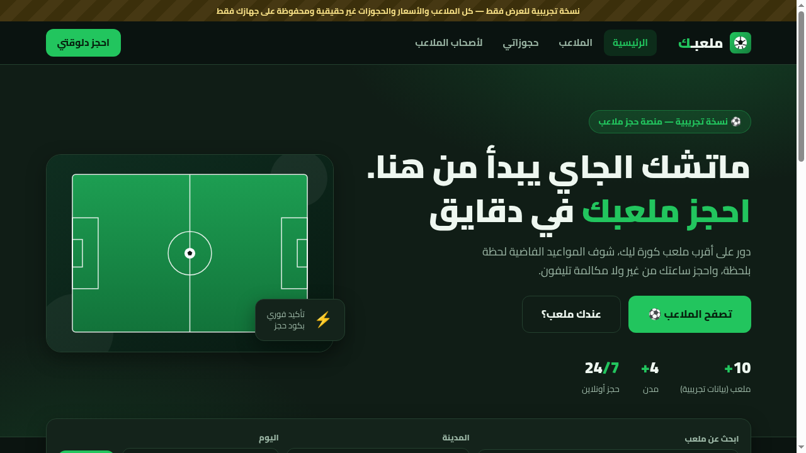

# Mal3abak (ملعبك) - Football Pitch Booking (Demo)

An Arabic, right-to-left web app concept for finding and booking football pitches. Browse pitches, pick a date and time slots, and confirm a booking in a few clicks.

**Live demo:** https://yosef-tamer206.github.io/Mal3abak-Pitch-Booking/



> This is a front-end prototype. All pitches, prices and areas are fictional demo data, and bookings are stored locally in the browser only. There are no real accounts, payments or reservations.

## Features

- Browse fictional pitches with photos, hourly price, size, surface, rating and amenities
- Filter and sort by city/area, max price and rating
- Pitch page with a weekly calendar and an hourly slot grid (available, booked, blocked)
- Multi-slot booking with a live price summary and a confirmation code
- "My bookings" page with cancellation
- Pitch-owner demo dashboard: today's bookings, upcoming bookings, expected weekly revenue and maintenance slot blocking
- Hash-based routing, no page reloads

## Tech Stack

- HTML5, CSS3, vanilla JavaScript (ES6+)
- `localStorage` for bookings, `sessionStorage` for the owner demo mode
- Cairo font (Google Fonts)

## Run Locally

```bash
git clone https://github.com/Yosef-Tamer206/Mal3abak-Pitch-Booking.git
cd Mal3abak-Pitch-Booking
```

Open `index.html` in a browser, or serve the folder with any static server.

## Notes

- Demo data lives in `data.js`; every name, price and location is made up to illustrate the idea.
- The owner dashboard login button is a display-only demo mode, not real authentication.
